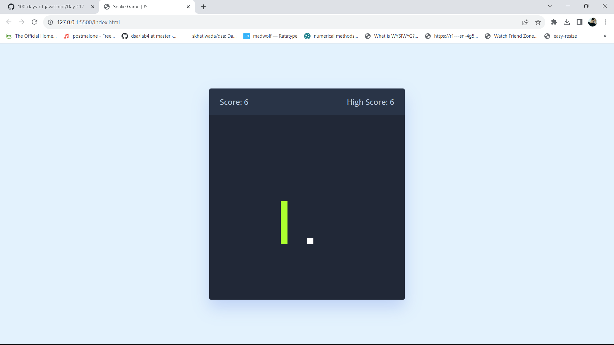

# Snake Game

Snake game in HTML, CSS and JavaScript with a saved high score.

## Features

- Arrow keys or W/A/S/D to move
- On-screen arrow buttons for phones
- Score and high score (kept in localStorage)
- Game over when the snake hits a wall or itself

## Run it

No build step. Open `index.html` in a browser, or serve the folder with any static server, for example `python -m http.server`.

## Screenshots

